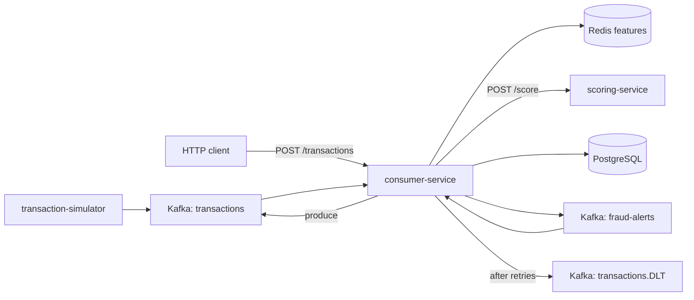
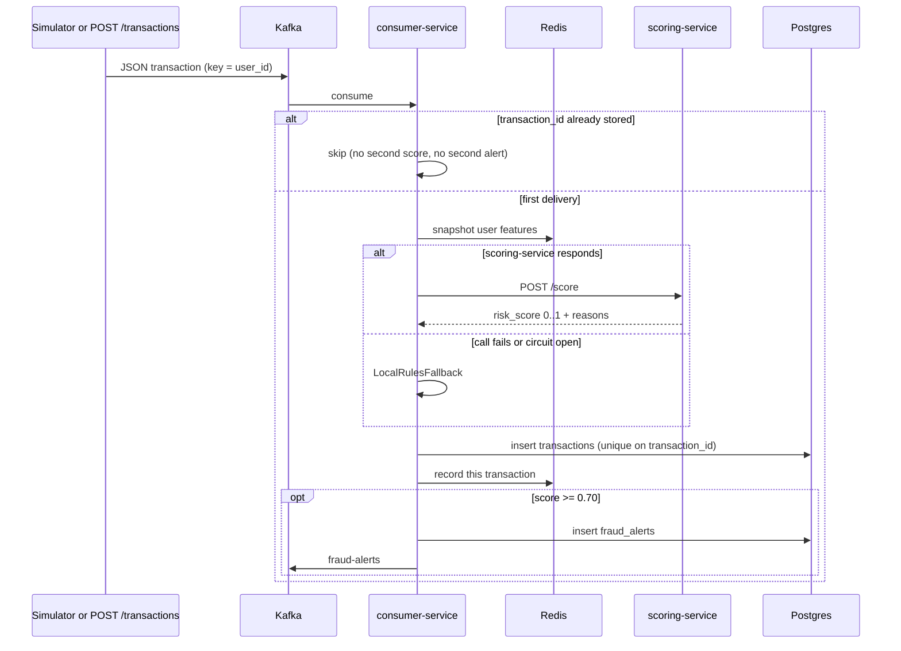

# FraudGuard

An earlier, larger version (Kubernetes, Terraform/AWS, Grafana, MCP) is preserved on the `archive/full-stack` branch.

## What it is

FraudGuard scores payment events as they arrive. A simulator or an HTTP call publishes a JSON transaction to Kafka; a Spring Boot consumer enriches it from Redis, asks a FastAPI rules service for a risk score, stores the result in PostgreSQL, and publishes high scores to `fraud-alerts`.

The companion project is the [distributed rate limiter](https://github.com/Lubhawani-Singh-Chouhan/Distributed-Rate-Limiter) (Spring Boot + Redis). That one protects an HTTP API. This one processes a stream.

## Architecture





```
fraudguard/
├── docker-compose.yml
├── services/
│   ├── consumer-service/       # Kafka consumer, REST, Postgres, Redis
│   ├── scoring-service/        # FastAPI rules engine
│   └── transaction-simulator/  # synthetic INR payment stream
└── docs/                       # JSON schema and a sample payload
```

Payload shape: [`docs/transaction-schema.md`](docs/transaction-schema.md).

## Tech stack

Java 21 · Spring Boot 3.3 · Spring Kafka · Resilience4j · Redis 7 · PostgreSQL 16 · Python 3.11 / FastAPI · Kafka (KRaft, Confluent image) · Docker Compose · GitHub Actions.

The consumer also uses Spring Data JPA, Spring Data Redis, and Actuator. Health is `GET /actuator/health` on the consumer and `GET /health` on the scoring service. Three Micrometer counters (`fraudguard.transactions.scored`, `fraudguard.alerts.published`, `fraudguard.transactions.fallback`) are registered on the consumer and exposed at `/actuator/metrics`.

Services log JSON to stdout.

## How to run

Docker is required. The first build is slow because the images run Maven and pip.

```bash
docker compose up --build
```

| What | URL |
|---|---|
| Inject / query | http://localhost:8081 |
| Scoring health | http://localhost:8000/health |
| Consumer health | http://localhost:8081/actuator/health |

Give Kafka about 30 seconds on a cold start, then:

```bash
curl -X POST http://localhost:8081/transactions \
  -H "Content-Type: application/json" \
  -d @docs/sample-high-risk.json

# the 202 body has transaction_id (generated when the sample omits it)
curl http://localhost:8081/transactions/<id>/score

curl "http://localhost:8081/alerts?since=2026-01-01T00:00:00Z"
```

```bash
docker logs -f fraudguard-simulator
docker logs -f fraudguard-consumer
```

```bash
docker exec -it fraudguard-kafka kafka-console-consumer \
  --bootstrap-server localhost:9092 --topic transactions --from-beginning --max-messages 5
```

`POST /transactions` only enqueues. The score shows up on `GET /transactions/{id}/score` after the consumer has written the row. Until then that GET returns 404.

## Tests

```bash
cd services/scoring-service
pip install -r requirements.txt
PYTHONPATH=. pytest -q

cd services/consumer-service
mvn -q test
```

Consumer tests use H2 (PostgreSQL mode) and Spring Kafka's embedded broker. They do not need Docker. The simulator has no tests. CI is [`.github/workflows/ci.yml`](.github/workflows/ci.yml): `mvn test package` for the consumer, `pytest` for scoring.

## Design decisions & trade-offs

**Kafka for the event path, REST for scoring and for inject/query.** The simulator and `POST /transactions` publish to `transactions` and return. They do not wait for a score, so a slow scorer does not stall the producer, and a second consumer can be added later without changing producers. The consumer calls scoring with a synchronous `POST /score` because the score is a request/response. A `scoring-requests` topic plus correlation ids would remove that hop; it is not here.

**After-processing offset commit (`AckMode.RECORD`).** `enable.auto.commit` is false. The listener container commits a record's offset only after the listener method returns. A crash mid-processing redelivers that record. That is at-least-once. `AckMode.RECORD` is used rather than a manual `Acknowledgment` so the commit still happens when the method returns, including when the error handler has recovered the record, without a separate ack call in the listener.

**Idempotent consumer.** Kafka will redeliver. `transactions.transaction_id` is the primary key and has a `UNIQUE` constraint. If the id is already stored, the consumer returns without scoring, without updating Redis, and without publishing another alert. If two deliveries race past that check, the losing insert hits the unique constraint and is also skipped. The duplicate is not sent to the dead-letter topic.

**Dead-letter topic.** Malformed JSON, and payloads missing `transaction_id` or `user_id`, throw from the listener. `DefaultErrorHandler` retries them with a fixed backoff (`fraudguard.listener.retry-interval-ms` = 1000, `retry-max-attempts` = 3, so three retries after the first failure). `DeadLetterPublishingRecoverer` then publishes the original record to `transactions.DLT` and the offset is committed, so one poison message does not block the partition. Retries do not make bad JSON valid; they are there so a transient failure and a poison message share one path.

**Circuit breaker plus local fallback.** The scoring call is wrapped in a Resilience4j circuit breaker (`scoringService`: 10-call window, 50% failure rate, 10s open, then 3 half-open calls). The HTTP client itself times out at 500ms connect and 1500ms read. Any failure, including an open circuit, uses `LocalRulesFallback` (amount, new device, velocity only). The listener returns normally, so the consumer keeps draining. Fallback scores are coarser than the Python rules. That is the availability trade-off. Alerts from the fallback are tagged `scoring_mode=fallback`.

**Rules engine, not a model.** Weights and thresholds live in `services/scoring-service/rules/scoring_rules.json`: amount bands, z-score against the user's own history, 5-minute velocity, new device, odd hour. The score is the sum of the matching weights, clamped to [0, 1]. `high` is >= 0.70, which is also the alert threshold. There is no learned model in this tree. An IsolationForest path used to sit behind a flag; it was trained on synthetic data and is only on `archive/full-stack`.

**Redis as a small feature store.** Per user: a hash of count / sum / sum of squares, a set of device ids, and a sorted set of recent timestamps. Features are read before the current transaction is recorded, so the scorer sees history only. This is not shared with the database transaction.

## Limitations / future work

- Redelivery after a successful insert is skipped entirely. If the process dies after the transaction row commits and before the alert publish finishes, the redelivery will not publish that alert.
- Redis updates are not rolled back when the Postgres transaction rolls back, so a failed attempt can double-count features on the retry.
- One Kafka broker, replication factor 1, producer `acks=1`. A broker crash can lose acknowledged records. There is no second copy.
- `POST /transactions` has no authentication.
- Rule weights are hand-set. They are not fitted on labeled fraud.
- Plain JSON. Bad records are retried and then written to `transactions.DLT`; nothing rejects them at produce time.
- Scoring is still a synchronous HTTP call on the consumer thread.

Later, still on this stack: a schema registry, an outbox so the alert publish happens after the database commit, and a separate scoring topic if the HTTP hop is the bottleneck.

## License

MIT
