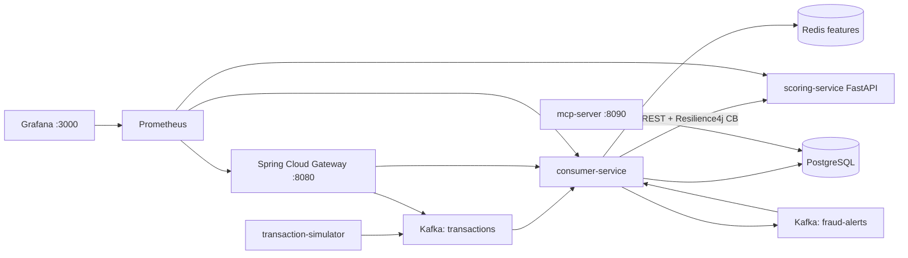
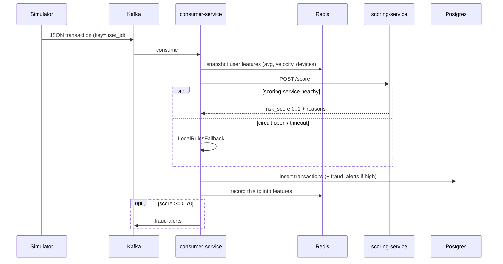

# FraudGuard

Kafka-driven payment fraud detection: simulated transactions go onto a `transactions`
topic, a Spring Boot consumer enriches them from Redis, a Python FastAPI service scores
them, results land in Postgres, and high-risk rows are published to `fraud-alerts`.

Local stack is Docker Compose. Kubernetes manifests are for kind/minikube. AWS stretch is
EC2 + S3 + ECR (not EKS).

This sits next to my [distributed rate limiter](https://github.com/) (Spring Boot + Redis).
That project was "protect an HTTP API." This one is "process a stream."

## Architecture





## Tech stack

Java 21 · Spring Boot 3.3 · Spring Cloud Gateway · Spring Kafka · Resilience4j · Redis 7 ·
PostgreSQL 16 · Python 3.11 / FastAPI · Kafka (KRaft, Confluent image) · Prometheus ·
Grafana · Docker Compose · Kubernetes (kind) · k6 · GitHub Actions · MCP (`mcp` Python SDK).

I used Java 21 here because that's what the rate limiter already runs on. Scoring is
**rules-based** (amount z-score, velocity, new-device, odd-hour). There is an IsolationForest
path behind `SCORING_MODE=ml` so I can talk about swapping the model without pretending I
shipped a real ML pipeline.

## Repo layout

```
fraudguard/
├── docker-compose.yml
├── k8s/                          # kind/minikube manifests + HPA on scoring-service
├── services/
│   ├── gateway-service/          # Spring Cloud Gateway
│   ├── consumer-service/         # Kafka → Redis → score → Postgres
│   ├── scoring-service/          # FastAPI rules engine
│   ├── transaction-simulator/    # synthetic INR payment stream
│   └── mcp-server/               # read-only MCP tools for Cursor/Claude
├── infra/aws/                    # Terraform: EC2 + S3 + ECR (stretch)
├── load-tests/k6/
└── docs/                         # JSON schema + MCP client setup
```

JSON schema for the Kafka payload: [`docs/transaction-schema.md`](docs/transaction-schema.md).
Avro + Schema Registry is future work — plain JSON is enough to inspect with
`kafka-console-consumer`.

## How to run (local)

Docker Desktop needs to be running. First time takes a while (Maven + pip inside image builds).

```bash
docker compose up --build
```

| What | URL |
|---|---|
| Gateway | http://localhost:8080 |
| Consumer API | http://localhost:8081 |
| Scoring | http://localhost:8000/health |
| MCP (LLM tools) | http://localhost:8090/health |
| Grafana (admin/admin) | http://localhost:3000 |
| Prometheus | http://localhost:9090 |

Give Kafka ~30s on a cold start, then:

```bash
# inject one transaction (or use docs/sample-high-risk.json)
curl -X POST http://localhost:8080/transactions ^
  -H "Content-Type: application/json" ^
  -d "@docs/sample-high-risk.json"

# wait a second, then (use the transaction_id from the 202 body)
curl http://localhost:8080/transactions/<id>/score

curl "http://localhost:8080/alerts?since=2026-01-01T00:00:00Z"
```

Watch the simulator in logs:

```bash
docker logs -f fraudguard-simulator
docker logs -f fraudguard-consumer
```

Confirm Kafka has messages (optional):

```bash
docker exec -it fraudguard-kafka kafka-console-consumer --bootstrap-server localhost:9092 --topic transactions --from-beginning --max-messages 5
```

### Grafana

Dashboards provision automatically under folder **FraudGuard**:

1. throughput & latency
2. fraud alert rate
3. service health / circuit breaker

Take screenshots from a live run for the README/portfolio. I did not commit fake graphs.

## MCP (ask the database in English)

`services/mcp-server` is a **separate** Python process using the official MCP SDK
(`FastMCP`). Cursor or Claude Desktop can call three read-only tools:

- `query_transactions` — filter `transactions` by user, dates, amount, min risk score
- `get_fraud_alerts` — filter `fraud_alerts` by user, dates, severity
- `get_user_risk_summary` — totals / flagged count / avg score / last flagged tx for one user

It comes up with the rest of the stack on **http://localhost:8090**. Cursor is already
wired via [`.cursor/mcp.json`](.cursor/mcp.json). Claude Desktop and the protocol
walkthrough: [`docs/mcp-setup.md`](docs/mcp-setup.md).

**Why read-only + parameterized SQL:** the model chooses *arguments* (`user_id`, dates),
not SQL. If we concatenated those strings into a query, a prompt like
`user_id = 1; DROP TABLE transactions` would be a real injection. Every value goes through
Pydantic then into a `%s` bind. The DB user is `fraudguard_readonly` (`SELECT` only), and
connections are opened with `readonly=True`. Full-table dumps are rejected (need at least
one filter; max 50 rows). Tool calls are capped at 30 / 60s per session.

Example prompts after Compose is up:

- Show me all high-risk transactions for user_042 in the last 7 days
- Any high-severity fraud alerts for user_001?
- Give me a risk summary for user_010

No extra UI — the chat client *is* the interface.

## Kubernetes (kind / minikube)

Compose is the path I actually iterate on. The manifests are there to show I can describe
the same topology as Deployments/Services plus an HPA.

```bash
# build images with tags the manifests expect
docker compose build
docker tag fraudguard-scoring-service fraudguard/scoring-service:1.0.0
docker tag fraudguard-consumer-service fraudguard/consumer-service:1.0.0
docker tag fraudguard-gateway-service fraudguard/gateway-service:1.0.0
docker tag fraudguard-transaction-simulator fraudguard/transaction-simulator:1.0.0

kind create cluster --name fraudguard
kind load docker-image fraudguard/scoring-service:1.0.0 --name fraudguard
kind load docker-image fraudguard/consumer-service:1.0.0 --name fraudguard
kind load docker-image fraudguard/gateway-service:1.0.0 --name fraudguard
kind load docker-image fraudguard/transaction-simulator:1.0.0 --name fraudguard

kubectl apply -k k8s/

kubectl -n fraudguard get pods
# gateway NodePort 30080, Grafana 30300, Prometheus 30090
```

HPA is on **scoring-service** only (CPU 70%, 1–3 replicas). That service is the compute hop;
the consumer is I/O (Kafka + Redis + HTTP). metrics-server must be installed in kind for HPA
to actually scale — without it the HPA object still applies, it just won't change replica
counts. I mention that in interviews instead of claiming I "designed autoscaling for
production."

## Tests

```bash
# scoring rules
cd services/scoring-service
pip install -r requirements.txt
PYTHONPATH=. pytest -q

# MCP validation / parameterized SQL / rate limit
cd services/mcp-server
pip install -r requirements.txt
pytest -q

# consumer fallback
cd services/consumer-service
mvn -q test

# gateway routes load
cd services/gateway-service
mvn -q test
```

CI: [`.github/workflows/ci.yml`](.github/workflows/ci.yml) runs those on push/PR.

## Load tests

k6 scripts live in [`load-tests/`](load-tests/README.md). Project 1 already has Gatling; this
one uses k6 for scoring HTTP latency.

```bash
k6 run load-tests/k6/scoring-latency.js
```

Target I set for myself: **p95 scoring < 200ms**. The rules engine is cheap; the number that
moves under load is consumer e2e (`fraudguard_pipeline_latency` on `:8081/actuator/prometheus`)
once Kafka + Redis + HTTP are in the path.

## Design decisions

- **Kafka instead of REST between producer and consumer.** The simulator should not care
  if scoring is slow. Kafka gives backpressure, replay (`--from-beginning`), and a place to
  hang a second consumer later (analytics) without touching the producer. I still call
  scoring over **sync REST** because wiring a `scoring-requests` topic + correlation ids is
  a bigger project; I'd do that next if the scoring p95 started to hurt.
- **Circuit breaker on the scoring call.** If FastAPI is down, the Kafka consumer should
  still drain the topic. Resilience4j opens after 50% failures in a 10-call window;
  `LocalRulesFallback` does a dumber amount/device/velocity check so we don't just drop
  messages. Trade-off: fallback scores are coarser, which I accept for availability.
- **HPA on scoring-service, not on the gateway.** Scoring is CPU (rules + optional sklearn).
  Gateway/consumer are I/O-bound and would scale on lag/connections, not CPU.
- **Rules engine as the real scorer.** I can explain every weight in
  `services/scoring-service/rules/scoring_rules.json`. The IsolationForest is behind a flag
  and trained on synthetic data — I would not put that on a resume as "ML fraud model."
- **No EKS.** Local kind already tells the Kubernetes story. AWS stretch is EC2 + S3 + ECR
  so I can say I pushed images and loaded rules from S3, then destroyed the box. See
  [`infra/aws/README.md`](infra/aws/README.md).
- **MCP tools never take a SQL string.** The LLM only fills typed arguments. Queries are
  parameterized, the role is SELECT-only, and unfiltered dumps are rejected. That is the
  difference between "an LLM can query my fraud DB" and "an LLM can wreck my fraud DB."

## Observability

- Spring: Micrometer → `/actuator/prometheus`
- FastAPI: `prometheus_fastapi_instrumentator` → `/metrics`
- Custom counters: `fraudguard_transactions_scored_total`,
  `fraudguard_alerts_published_total`, `fraudguard_transactions_fallback_total`
- JSON logs (`logstash-logback-encoder` / `python-json-logger`) so this would ship to
  CloudWatch without reformatting

## AWS stretch

Terraform in `infra/aws/` creates ECR repos, an S3 bucket with the rules JSON, and one
EC2 instance with Docker. Set `AWS_S3_BUCKET` on scoring-service to load rules from S3
(`app/s3_loader.py`); it falls back to the image file if S3 isn't there.

I treat this as "deployed to validate," not "ran in production." Tear it down after
screenshots (`terraform destroy`).

## Future work

- Avro + Schema Registry instead of plain JSON
- Fully async scoring over a Kafka topic (the sync REST hop is the obvious bottleneck)
- A real feature store (Feast) instead of a Redis hash
- Dedicated alert-service that pages / webhooks instead of logging in the same JVM
- Strimzi for Kafka on k8s instead of a single Bitnami broker
- Proper ML training pipeline if I ever get labelled data that isn't synthetic

## Resume bullets (draft)

- Built a Kafka-based fraud detection pipeline that enriches simulated UPI/card payments
  from Redis, scores them in a FastAPI service, and stores results in PostgreSQL.
- Implemented a Resilience4j circuit breaker on the consumer → scoring call with a local
  rules fallback so the Kafka consumer keeps draining when scoring is down.
- Deployed the stack with Docker Compose and Kubernetes (kind), with Prometheus/Grafana
  dashboards and an HPA on the scoring service; validated AWS via EC2, ECR, and S3.

## 60-second walkthrough

"It's a small event-driven payments pipeline. A simulator publishes JSON transactions to
Kafka. A Spring Boot consumer looks up that user's recent spend in Redis — count, average,
stddev, devices, 5-minute velocity — then calls a Python scoring service. Scoring is
weighted rules I can explain: high amount, z-score vs the user's own history, velocity,
new device. If the Python service is slow I trip a circuit breaker and fall back to a
dumber local check so Kafka doesn't pile up. High scores go to Postgres and a fraud-alerts
topic. Gateway is just Spring Cloud Gateway in front for inject/query. I run it all in
Compose, with k8s manifests for kind, and I did not put this on EKS."

## License

MIT
